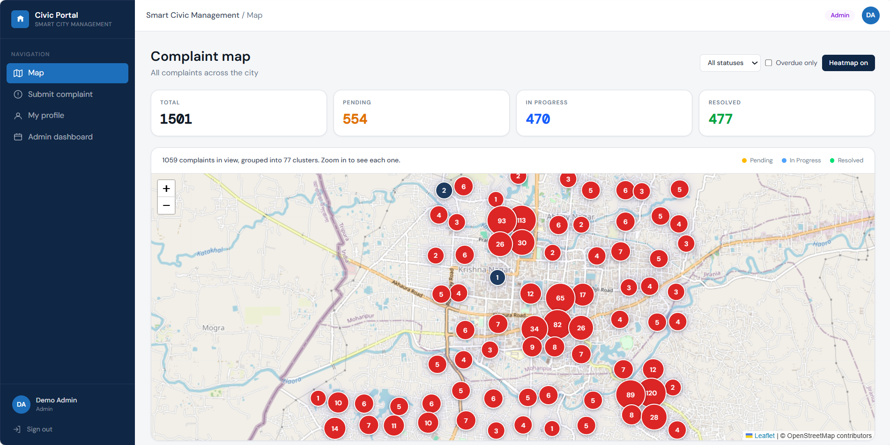
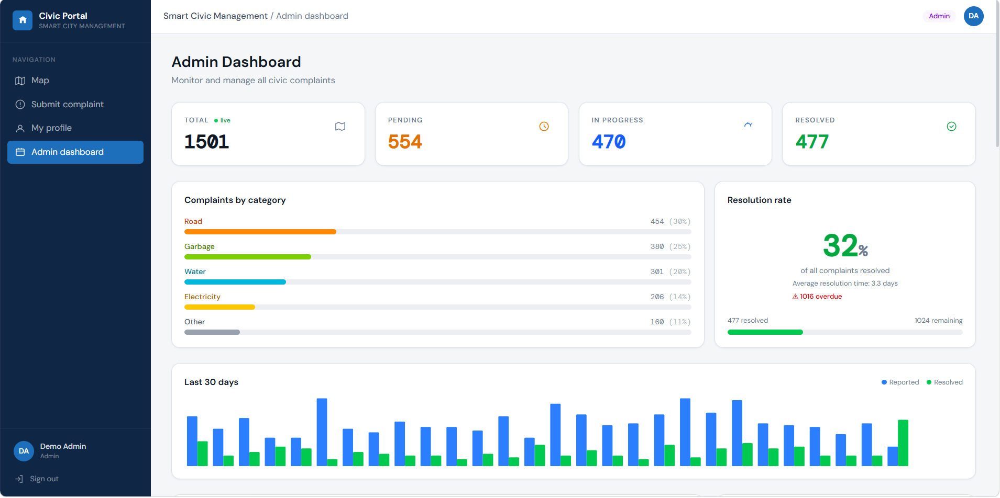
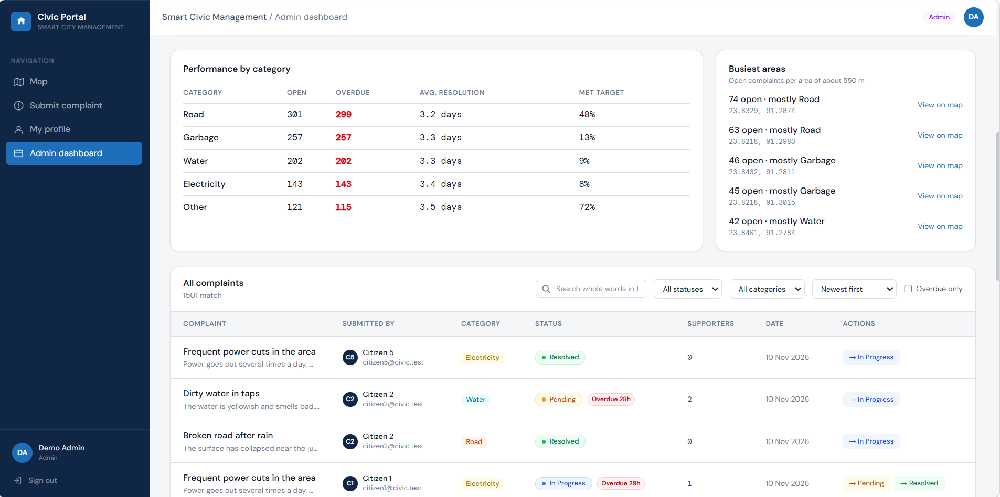
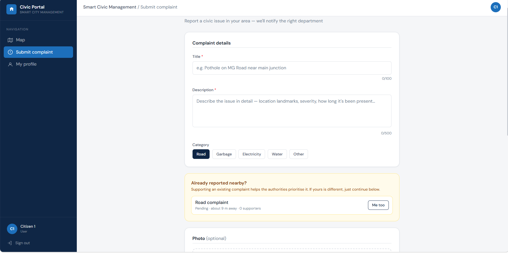
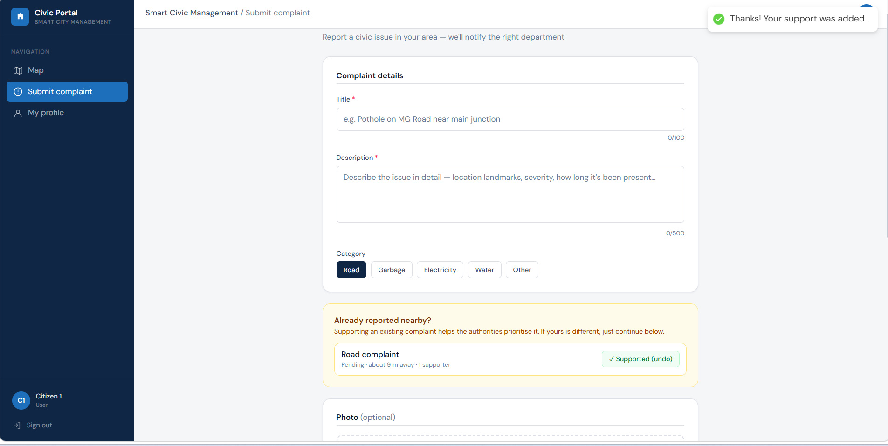
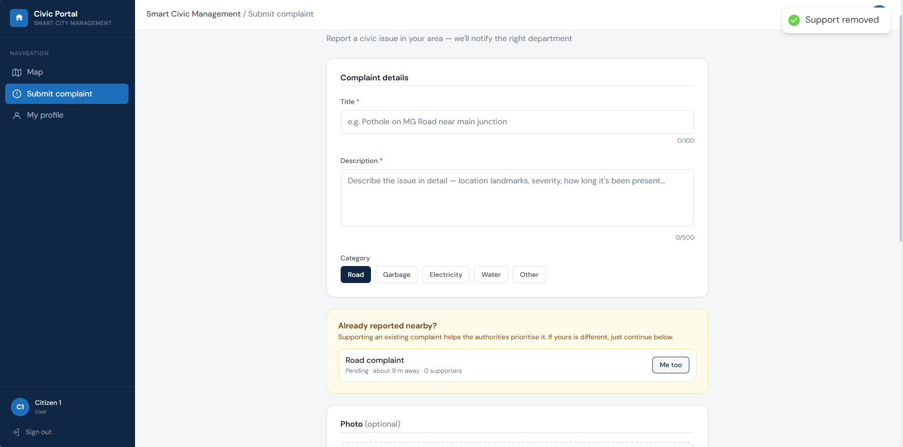
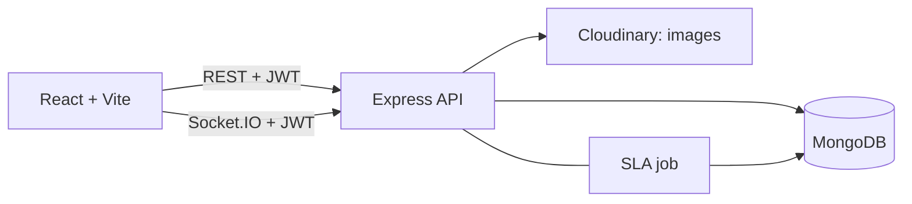

# Smart Civic System

[](https://github.com/raj-balram/SMART-CIVIC-SYSTEM/actions)

Citizens report civic problems (potholes, garbage, water, power) on a map. Admins triage, resolve and track them against service deadlines, with live updates.

**Live demo:** https://smart-civic-system.vercel.app/map · **API health:** https://smart-civic-system-backend.onrender.com/health  
*Hosted on free tiers, so the first request after a quiet period can be slow.*


## Screenshots

### Admin Map


### Dashboard Analytics



### Nearby Complaint Detection



### Real-time Status Notification



## What it does

**For citizens:** report a problem with a photo and GPS location. If similar open complaints exist within 150 m, the form offers **"Me too"** instead of a duplicate. They get live toasts with the admin's notes as the status changes.

**For admins:** a paginated, searchable dashboard; a status workflow with history; service-level deadlines with automatic **overdue** flagging and alerts; analytics per category; "busiest areas"; and a map that stays fast with thousands of complaints (pins when zoomed in, clusters when zoomed out, plus a heatmap).

## Architecture



## Engineering decisions

- **Live updates are scoped by rooms.** Sockets are authenticated at connection time and joined to `admin` and `user:<id>` rooms, with the role read from the database. A test suite proves a citizen never receives another user's complaint, including with forged or deleted-user tokens.
- **Status changes are atomic.** One conditional update means two admins can't both win, and every change is recorded in a history (who, when, note). Citizens see notes but never which admin acted.
- **"Me too" is idempotent.** A single conditional write adds one supporter per person; 20 simultaneous requests from one user count once. The list of supporters is never sent to clients.
- **Service levels.** Each category has a target time. A background job flags overdue complaints exactly once, even with several server instances, and alerts admins.
- **Scale lives in the database.** Pagination, filters, text search, statistics and map clustering are indexed MongoDB queries. Sorts end with `_id` so paging is stable without an in-memory sort.
- **Hardening.** Zod validation on every input, one central error handler (no internal details leak), rate limits (per IP for login and registration, per user for creating complaints and supporting), helmet, upload checks (type allow-list plus file signature), and admins created by a script rather than a public endpoint.
- **Safe data migrations.** Scripts are idempotent and dry-run by default, and are covered by tests.

### Index evidence (`npm run explain`, 301 complaints)

| Query | Plan | Documents examined |
|---|---|---|
| Admin list, Pending, newest first | `LIMIT -> FETCH -> IXSCAN` | 20 for 20 returned |
| Text search | `LIMIT -> TEXT_MATCH -> FETCH -> IXSCAN` | 20 |
| Search by title with no index (for contrast) | `COLLSCAN` | 301 |

## API

| Method | Path | Notes |
|---|---|---|
| POST | `/api/auth/register`, `/api/auth/login` | JWT; the role is never taken from the request |
| GET, PUT | `/api/auth/me` | profile |
| POST | `/api/complaints` | multipart, with an optional image |
| GET | `/api/complaints` | my complaints |
| GET | `/api/complaints/nearby` | open complaints near a point (any user) |
| POST, DELETE | `/api/complaints/:id/support` | "me too" and undo |
| GET | `/api/complaints/list` | admin: paginated, filtered, searched, sorted |
| GET | `/api/complaints/map` | admin: viewport pins or clusters |
| GET | `/api/complaints/stats`, `/api/complaints/analytics` | admin |
| PUT | `/api/complaints/:id/status` | admin: validated workflow transitions |
| GET | `/health` | database status |

Socket events: `complaint:created`, `complaint:updated`, `complaint:supported` (to admins and the owner) and `complaint:overdue` (to admins).

## Run it locally

“Photo uploads need Cloudinary credentials in backend/.env. Without them everything else works and photo attachments are refused with a clear message.”

```bash
docker compose up -d            # MongoDB on port 27019
cd backend
cp .env.example .env            # Windows: copy .env.example .env, then fill it in
npm install
npm run seed                    # demo data (SEED_COUNT=1500 for a bigger map)
npm run dev
# second terminal
cd frontend && cp .env.example .env && npm install && npm run dev
```

Demo logins after seeding: `admin@civic.test` / `Admin@12345` and `citizen1@civic.test` / `Citizen@12345`.

Everything in one command: `docker compose -f docker-compose.full.yml up --build`, then open http://localhost:8080.

## Tests

```bash
cd backend && npm test          # 102 tests, using an in-memory MongoDB
```
They cover auth, roles, validation, upload checks, rate limits, socket privacy, the status workflow (including concurrent requests), support, SLA escalation, pagination and search, the clustered map, analytics and the data migrations. CI runs them on every push.

## Deployment

Frontend on Vercel, API on Render, database on MongoDB Atlas. Required settings are listed in `backend/.env.example`.

## Known limitations

- Search matches whole words, and reporters can't be searched by name.
- The supporters list is stored on the complaint, which is fine into the thousands; beyond that it should move to its own collection.
- Rate limits are in server memory, so with several instances they would move to Redis.
- Analytics scan the collection, so beyond ~100k complaints they should be cached or pre-aggregated.
- Service deadlines are constants in code; a real deployment would let each department configure them.
- The JWT lives in localStorage; an httpOnly cookie would also need CSRF protection.